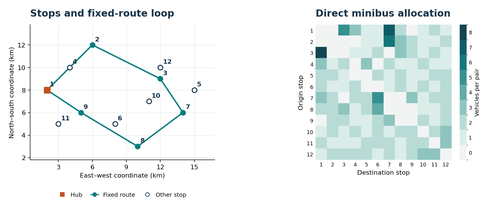

# Mixed-fleet bus scheduling

[](https://github.com/Azure-127031/mixed-fleet-bus-scheduling/actions/workflows/reproduce.yml)

[中文说明](README.zh-CN.md) · [Reproduction guide](docs/reproduction.md) · [Run-level data](results/runs.csv) · [Cite this code](CITATION.cff)

How many large and medium buses should run in each direction, and how many minibuses should serve direct trips? This repository accompanies *Mixed-Fleet Bus Scheduling with Fixed Routes and Flexible Minibuses*. It includes the original integer model, three search implementations and an exact reference for a simulated 12-stop corridor.



Large and medium buses follow the loop **1 → 2 → 3 → 7 → 8 → 9 → 1** in both directions. The matrix shows how **224 minibuses** serve **116 directed stop pairs**. Read each row as an origin and each column as a destination. [Model inputs](original/goal.py) · [Exact allocations by stop pair](results/case.json)

## Try the exact reference

```sh
git clone https://github.com/Azure-127031/mixed-fleet-bus-scheduling.git
cd mixed-fleet-bus-scheduling
python reference.py
```

This calculation uses the Python standard library. It enumerates 1,326 feasible pairs of large-bus counts under the large-fleet limit and computes the medium-bus requirement in each direction.

```text
Optimal normalized objective: 6268.946555
Forward (large, medium): (24, 5)
Reverse (large, medium): (26, 2)
```

## Reproduce the comparison

With Python 3.10.18, run the following from the repository root.

```sh
python -m pip install -r requirements.txt
python reproduce.py
```

The command solves the model with CBC, reruns all three searches and checks each final allocation against the archived record. Each method gets 6,500 fitness calls for each of 20 paired seeds on the same demand matrix. Lower scores are better.

| Search method | Mean normalized objective | Runs reaching the exact optimum |
| --- | ---: | ---: |
| Mixed-search particle swarm (MSPSO) | 6,352.2 | 5 / 20 |
| Hybrid particle swarm and Harris hawks (FPSOHHO) | 6,441.6 | 4 / 20 |
| Harris hawks (HHO) | 8,552.5 | 0 / 20 |

MSPSO and the hybrid both recovered the exact allocation cost. MSPSO had the lower mean under this evaluation budget. The twenty seeds measure variation in search on one instance. [Individual runs](results/runs.csv) · [Protocol and output fields](docs/reproduction.md)

## Explore the implementation

| To inspect | Open |
| --- | --- |
| Stop coordinates, demand, capacity constraints and objective | [Original scheduling model](original/goal.py) |
| Search updates and switching logic | [HHO](original/HHO.py) · [MSPSO](original/MSPSO.py) · [FPSOHHO](original/FPSOHHO.py) |
| Derivation and verification of the reference value | [Standard-library enumeration](reference.py) · [CBC cross-check](verify_case.py) |
| Common evaluation budget, seeds and final allocations | [Experiment driver](check_search.py) · [Raw results](results/) |

## Citation and license

For research use, cite the software and record the release or commit used. GitHub's **Cite this repository** button reads the software citation metadata. [Citation metadata](CITATION.cff) · [Releases](https://github.com/Azure-127031/mixed-fleet-bus-scheduling/releases) · [MIT License](LICENSE)
