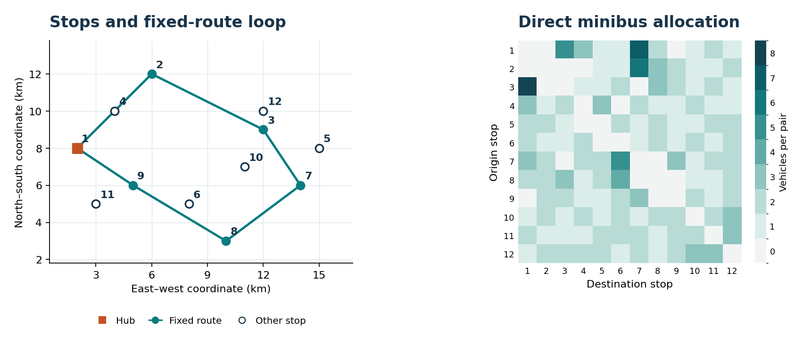

# 混合车型公交调度

[English](README.md) · [实验复现说明（英文）](docs/reproduction.md) · [逐次实验结果](results/runs.csv) · [引用信息](CITATION.cff)

本仓库是论文 *Mixed-Fleet Bus Scheduling with Fixed Routes and Flexible Minibuses* 的配套代码。研究问题是，在一个调度时段内，固定线路的正反两个方向各需派多少辆大巴、中巴，以及每个起终点组合需派多少辆直达小巴。



大巴和中巴沿 **1 → 2 → 3 → 7 → 8 → 9 → 1** 双向运行。右图每一行代表起点，每一列代表终点，颜色表示分配车辆数。这个算例的 116 个有直达需求的起终点组合共使用 **224 辆小巴**。[站点坐标与需求矩阵](original/goal.py) · [逐对分配明细](results/case.json)

## 先算出精确最优值

```sh
git clone https://github.com/Azure-127031/mixed-fleet-bus-scheduling.git
cd mixed-fleet-bus-scheduling
python reference.py
```

这一步只需 Python 标准库。程序枚举满足大巴总量限制的 1,326 组正反向大巴数，计算对应的最少中巴数。精确目标值为 **6268.946555**，其中一组最优配置为正向 **24 辆大巴、5 辆中巴**，反向 **26 辆大巴、2 辆中巴**。目标值采用模型的归一化计分单位。

## 复现三种算法的 60 次运行

在仓库目录下使用 Python 3.10.18 运行以下命令。

```sh
python -m pip install -r requirements.txt
python reproduce.py
```

程序会重新求解整数模型，再运行三种算法，逐个核对随机种子、目标值、发车方案及评价次数。每种算法使用相同的 20 个种子，每次可调用目标函数 6,500 次，目标值越低越好。

| 算法 | 平均目标值 | 命中精确最优 |
| --- | ---: | ---: |
| 混合搜索粒子群 MSPSO | 6352.2 | 5 / 20 |
| 粒子群与哈里斯鹰混合算法 FPSOHHO | 6441.6 | 4 / 20 |
| 哈里斯鹰 HHO | 8552.5 | 0 / 20 |

在这条走廊和这个预算下，MSPSO 和 FPSOHHO 都达到过精确最优值，MSPSO 的平均目标值更低。20 个种子使用同一张需求矩阵。原稿的历史十次对比使用另一套实验配置。[60 条运行记录](results/runs.csv) · [原始算法实现](original/) · [MIT 许可证](LICENSE)
